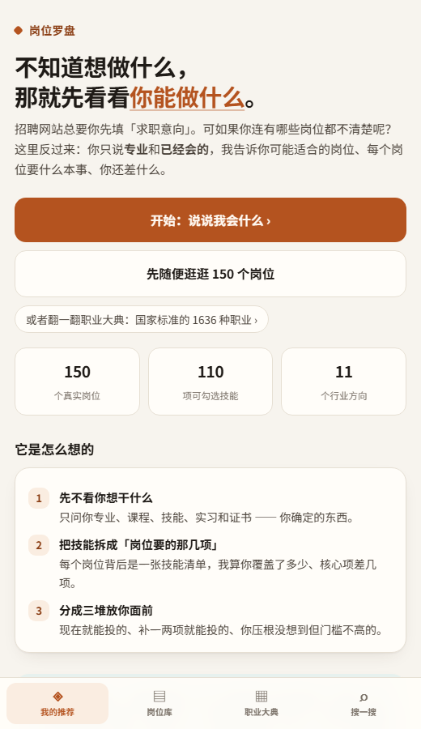
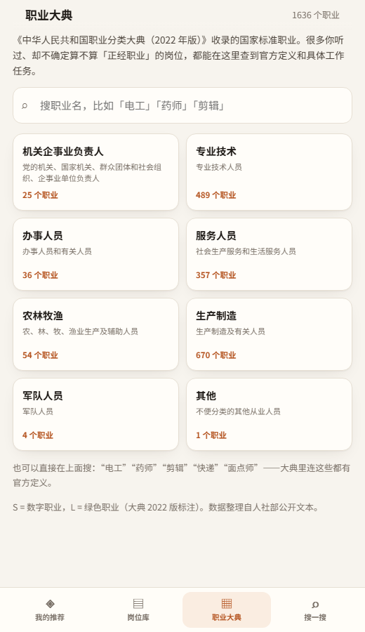

# 岗位罗盘

> 招聘网站总先问你「想找什么工作」。可如果你根本不知道有哪些工作呢？
> 这个应用反过来：**你只说专业和已经会的，它告诉你可能适合的岗位，以及还差什么。**

面向刚毕业、还没毕业、暂时待业的人。不填求职意向，不注册，不联网，数据只存在你自己的手机里。

---

## 目录

- [它能做什么](#它能做什么)
- [三种打开方式](#三种打开方式)
- [装到手机上](#装到手机上)
- [数据与内容](#数据与内容)
- [改数据 / 加岗位](#改数据--加岗位)
- [项目结构](#项目结构)
- [它的边界](#它的边界)

---

## 它能做什么
1. **三步自评**：学历 / 状态 / 专业 → 勾选已经会的技能（了解 / 会用 / 熟练）→ 可选的偏好（坐办公室还是跑外面、跟人还是跟数据、每周能学几小时）。
2. **反向推荐**：把每个岗位拆成一张技能清单，算你覆盖了多少、核心项差几项，分成三堆：
   - ① **现在就能投**：核心技能基本齐
   - ② **补一补就能投**：差 2–4 项，3–6 个月
   - ③ **你可能没想到的方向**：跨赛道但门槛不高
3. **岗位详情页**：每天真实在做什么（不是 JD 套话）、需要会什么并标出你的差距、最该补的三项、0–12 个月入门路线（含考证时间线）、薪资三档与 3–5 年去处、**没人告诉你的部分**（劝退点）、以后能转到哪，以及它在**国家职业分类大典**里对应的官方名称与定义。
4. **职业大典**：收录《中华人民共和国职业分类大典（2022 年版）》的 **1636 个职业**，按 8 个大类浏览，或直接搜索。每个职业都有官方定义、主要工作任务清单、所属分类路径。很多你干过却没当回事的活儿（电工、面点师、快递员），在这里都是有名字、有定义的正式职业。
5. **全文检索**：搜岗位名、技能、行业、甚至搜「不加班」「稳定」「出差」。也可以**整段粘贴一条招聘 JD**，看它最像哪个岗位。
6. **离线 + 可安装**：装到手机桌面后断网可用，像一个真正的 App。

覆盖 150 个岗位、110 项技能、11 个方向：互联网/软件、产品/设计、运营/市场、销售/商务、职能/财务、金融、教育、医疗/健康、制造/工程、传媒/内容、公共服务/其他。

### 界面

| 首页 | 推荐结果 | 岗位详情 |
|---|---|---|
|  |  |  |

| 自评：勾技能 | 岗位库 | 搜索 |
|---|---|---|
|  |  |  |

| 职业大典（8 大类） | 大典职业详情 |
|---|---|
|  |  |

（截图是 390×844 的手机视口，数据为示例用户「汉语言文学 + 写作/编辑」的结果。）

---

## 三种打开方式

### 1）电脑上双击就能看（最省事）

生成一个自带全部数据的单文件：

```powershell
python scripts\build_data.py          # 合并岗位数据
python scripts\build_dadian.py        # 生成职业大典数据
python scripts\build_singlefile.py    # 打包单文件
```

然后双击 `dist\岗位罗盘.html`。不需要联网、不需要装任何东西。

### 2）在手机上用（推荐，能装成 App）

电脑和手机连同一个 Wi-Fi，在电脑上执行：

```powershell
python scripts\serve.py
```

终端会打印两行地址，把 **手机：** 那一行的地址在手机浏览器里打开。
（默认 8765 端口；换端口用 `python scripts\serve.py -p 9000`。）

### 3）部署到静态托管

整个 `app/` 文件夹就是完整的网站，属性和普通静态站一样。传到任意静态托管（GitHub Pages、Cloudflare Pages、Vercel、对象存储）即可，`index.html` 就是入口。没有后端、没有数据库。

---

## 装到手机上

打开上面的局域网地址后：

- **Android（Chrome / Edge）**：右上角菜单 →「添加到主屏幕」/「安装应用」。
- **iPhone（Safari）**：底部「分享」→「添加到主屏幕」。

装好后图标叫「岗位罗盘」，全屏打开，断网也能用（数据已经缓存在本地）。

> 注意：Service Worker 只在 `http://` 或 `https://` 下生效。直接用 `file://` 打开单文件版也能用，只是没有「离线缓存」和「安装」这两件事——但单文件本身就已经是离线的。

---

## 安卓安装包（APK）

不想装服务器、也不想「添加到主屏幕」？直接装 APK。

- **文件**：`dist/岗位罗盘.apk`（约 0.7 MB，内含全部 150 个岗位 + 1636 个职业大典条目）
- **要求**：Android 7.0 及以上（minSdk 24）
- **权限**：**一个都没有**。没有申请 INTERNET 权限，所以它物理上连不上网，数据全在安装包里
- **签名**：自签名（v2 + v3），第一次装需要在系统里允许「安装未知来源应用」

装法：把 apk 传到手机（数据线 / 微信文件传输助手 / 网盘都行）→ 点开 → 允许安装 → 完成。
桌面上会出现「岗位罗盘」图标，点开即用，地铁里没信号也能用。

### 自己重新打包

需要 JDK 17 和 Android SDK（build-tools 34 + platform 33）：

```
tools/jdk/                     JDK 17
tools/android-sdk/
  build-tools/34.0.0/
  platforms/android-33/
```

然后：

```powershell
python scripts\build_apk.py
```

它会：把 `app/` 整个复制进 assets → `aapt2 compile/link` → `javac` + `d8` →
打包 `classes.dex` → `zipalign` → 用 `tools/jobcompass.keystore` 签名。
不用 Gradle，也不需要 Android Studio。

源码在 `android/`：一个 20 行的 `MainActivity`（WebView 壳）+ 清单 + 主题 + 图标。
换签名要重新生成 keystore；**换了签名再覆盖安装会失败，得先卸载旧版**。

---

## 数据与内容

- 岗位内容、技能要求、入门路线：按公开招聘要求、行业公开讨论和从业者描述整理，**不是**从某个数据库抓的。
- 薪资：`入门 / 3–5 年 / 资深` 三档区间，口径为**一线或新一线城市、税前月薪（千元）**，个别岗位（公务员）标注为到手。**全部是参考估算，不是官方统计**，同一岗位在不同城市和公司差别很大。
- 每个岗位的「没人告诉你的部分」是刻意保留的劝退点。一个只讲好话的推荐工具没有用。
- 数据说明集中在应用的「关于」页里也有一份。

### 外部数据来源与许可

**职业分类大典（1636 个职业）**

- 原文：《中华人民共和国职业分类大典（2022 年版）》社会公示稿，人力资源和社会保障部组织编制。
- JSON 整理：[leo4stone/ZHONGHUARENMINGONGHEGUOZHIYEFENLEIDADIAN](https://github.com/leo4stone/ZHONGHUARENMINGONGHEGUOZHIYEFENLEIDADIAN)（整理工作 MIT 许可；原始文本版权归原编制单位）。原始文件已下载到 `data/external/`，可溯源。
- 用法：进入「职业大典」页浏览/搜索；每个岗位详情页底部显示它在国家分类里的对应名称与定义。
- **局限**：互联网行业的岗位命名（产品经理、前端、运营）在大典里往往没有同名条目，`scripts/build_dadian.py` 里的 150 条映射是人工挑选的「最接近」条目，界面上也没有假装是精确对应。大典给的是国家标准的职业定义，不含薪资、门槛、学习路线。

**调研过的同类 GitHub 项目**（未直接使用其数据，仅作参考）

| 项目 | 有什么 | 为什么没直接用 |
|---|---|---|
| [GENI-Technology/careerPathPrediction](https://github.com/GENI-Technology/careerPathPrediction) | 按现有职业+技能推荐转岗路径并指出技能差距 | 思路和本应用最接近，但数据是英文 O*NET 子集，岗位粒度对不上中国校招 |
| [dkavargy/escox3](https://github.com/dkavargy/escox3) / ESCO 系列 | 欧盟 ESCO 技能-职业图谱（含绿色技能） | ESCO 无中文，3000+ 职业需要全量翻译才可用 |
| [Jybbs/chalkline](https://github.com/Jybbs/chalkline) | 从 O*NET 30.0 整理的职业-技能映射 | 同上，英文职业名，且是工程内部的提交，不是独立数据集 |
| [eslemguler/Linkedin-Dataset](https://github.com/eslemguler/Linkedin-Dataset) | LinkedIn 技能重要性数据 | 只有技能热度，没有职业定义与工作任务 |

结论：**中文场景下，「职业分类 + 官方定义」这块公开数据最全的就是职业大典**，所以选它接进来；O*NET/ESCO 的「技能重要性」和「相邻职业」值得以后做，但要先解决翻译和粒度对齐。

---

## 改数据 / 加岗位

所有内容都在 `data/` 里，纯 JSON，改完重新生成即可：

```
data/
  skills.json       技能词表（110 项，分 13 类）
  jobs/*.json       岗位数据（按批次分文件，格式见 data/_SCHEMA.md）
  _SCHEMA.md        字段说明 + 语气要求 + 完整岗位 id 清单
  external/         外部原始数据（职业大典 JSON，仅供 build_dadian.py 读取）
```

加一个岗位：

1. 在 `data/jobs/` 任意一个 json 里追加一个对象（或在清单里加新 id 后单独建文件）；
2. `skills[].id` 只能从 `data/skills.json` 里选；
3. 跑 `python scripts\build_data.py` —— 它会校验字段、技能 id、相邻岗位引用、薪资区间、学习阶段，不通过会列出具体问题；
4. 想让它挂上大典条目，在 `scripts\build_dadian.py` 的 `JOB_MAP` 里加一行（编码必须是 1636 个职业之一，脚本会校验）；
5. 跑 `python scripts\build_dadian.py`，再跑 `python scripts\build_singlefile.py`。

要加一个新的技能类别或新技能，改 `data/skills.json` 即可，界面会自动按 `cat` 分组。

---

## 项目结构

```
app/                    ← 整个应用（静态站点）
  index.html
  styles.css
  app.js                ← 全部逻辑：路由、打分、检索、渲染
  data.js               ← 生成物：window.JOB_DATA = {...}
  dadian.js             ← 生成物：window.DADIAN = {...}（1636 个职业）
  sw.js                 ← Service Worker，离线缓存
  manifest.webmanifest
  icons/                ← 图标（由 scripts/make_icons.py 生成）

data/                   ← 内容源文件
  external/             ← 职业大典原始 JSON
android/                ← Android 壳（清单、MainActivity、图标、主题）
tools/                  ← 本地工具链：jdk17 + android-sdk（仅打包 APK 用，可删）
scripts/
  build_data.py         ← 校验 + 合并岗位数据
  build_dadian.py       ← 生成大典数据 + 150 条岗位映射
  build_singlefile.py   ← 打包 dist/岗位罗盘.html
  build_apk.py          ← 不用 Gradle，直接打 APK
  serve.py              ← 局域网服务，方便手机打开
  make_icons.py         ← 生成图标
  smoke_test.js         ← 无浏览器冒烟测试
dist/岗位罗盘.html       ← 生成物：双击即用的单文件版（约 1.6 MB）
dist/岗位罗盘.apk        ← 生成物：安卓安装包（约 0.7 MB）
```

技术栈：**零依赖**。原生 HTML/CSS/JS，没有框架、没有构建、没有 npm install。
检索是自己实现的 BM25，中文按「单字 + 二元组」切分，所以不需要分词库也能搜中文。

---

## 它的边界

- 150 个岗位覆盖不了真实世界的全部职业，尤其是细分行业和新兴岗位；大典那 1636 个只有「定义 + 工作任务」，没有薪资和学习路线。
- 岗位 ↔ 大典的映射是「最接近」，不是一一对应：大典里没有「产品经理」这种互联网叫法。
- 匹配度是「技能重合度 + 少量偏好调整」，**不是录用概率**，也不衡量你的性格、家庭条件、城市机会。
- 没有城市选择，薪资用一线/新一线口径。如果你在三四线，普遍要往下调。
- 它不会替你做决定。它只是把一个模糊的问题——「我能干什么」——拆成一张能看的表。
